# Database Indexes: Visual Notes

## 1. The problem indexes solve

A database stores rows in **pages** on disk. Without an index, a query reads page after page and tests every row (a **full table scan**, O(N)). With millions of rows this is very slow.

An **index** is a separate lookup structure that records where a value lives, so the database can jump straight to the right page.

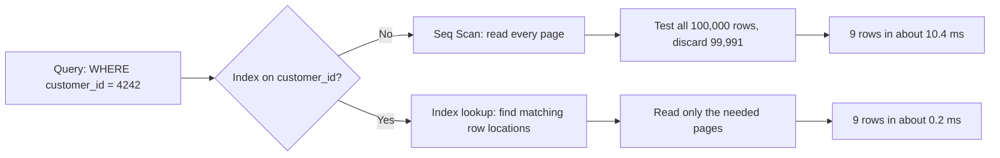

My EXPLAIN ANALYZE run: Seq Scan (cost 2037) became Bitmap Index Scan + Bitmap Heap Scan (cost about 41), roughly 50x faster.

## 2. Types of indexes

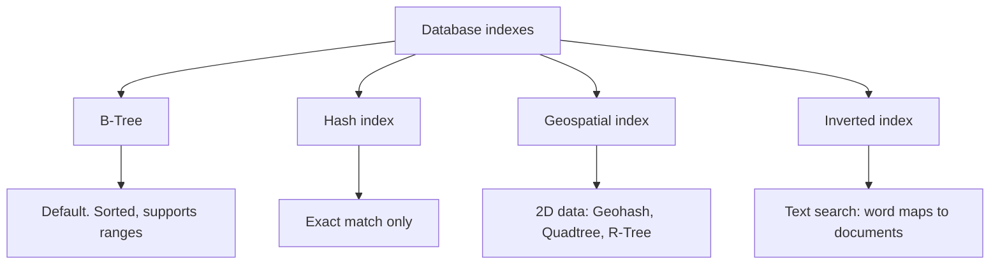

### 2.1 B-Tree

A self-balancing tree. Each node holds a sorted list of keys and pointers to child nodes; leaves point to the rows or pages. Lookups are O(log N), and because keys are sorted it supports equality, ranges and ORDER BY.

**Point lookup: search for 45**

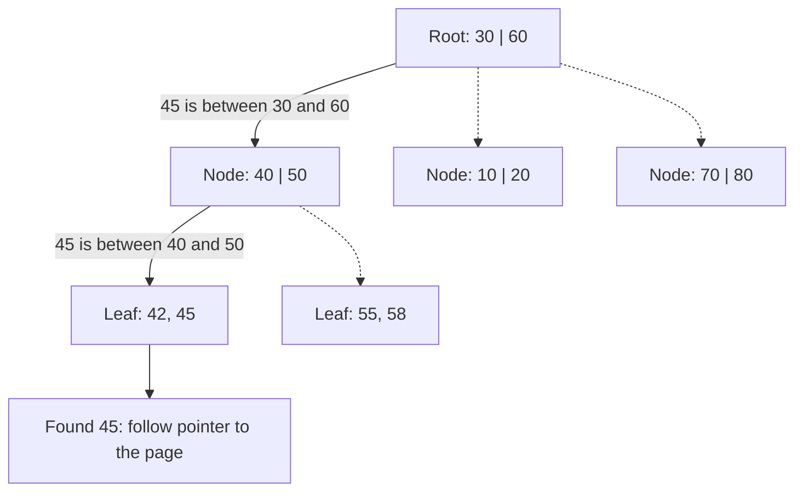

**Range query: WHERE value BETWEEN 42 AND 58** (leaves are linked, so after finding the start the database just walks right)

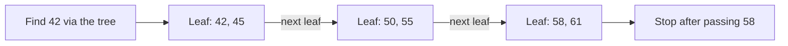

### 2.2 Hash index

Works like a hash map (closer to `unordered_map`). Hash the key, jump to the bucket. Fast for equality, useless for ranges because there is no ordering.

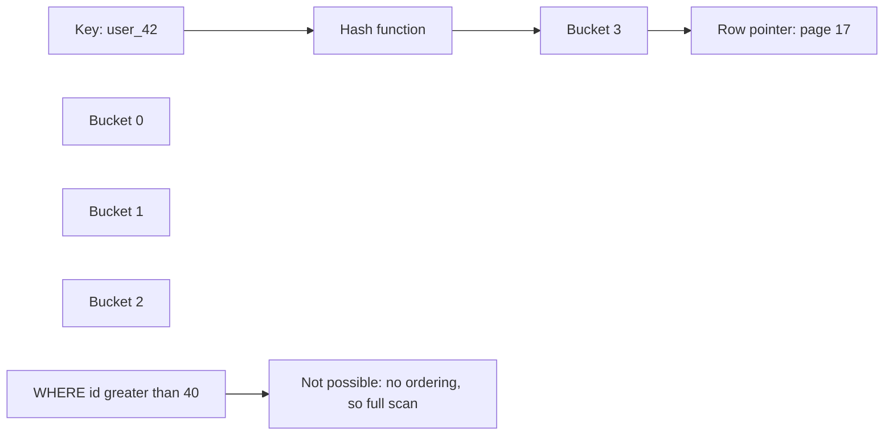

Redis is a key-value store built on hash tables, which is related but not the same as a hash index inside an RDBMS. PostgreSQL has hash indexes but they are rarely used.

### 2.3 Geospatial indexes

B-trees are great for 1D data but poor for 2D data (lat/long), because one sorted order cannot keep nearby points close in both dimensions.

#### Geohash

Encodes a location into a string. Each extra character narrows the area, and nearby places share a prefix, so a nearby search becomes a prefix search that a B-tree can handle.

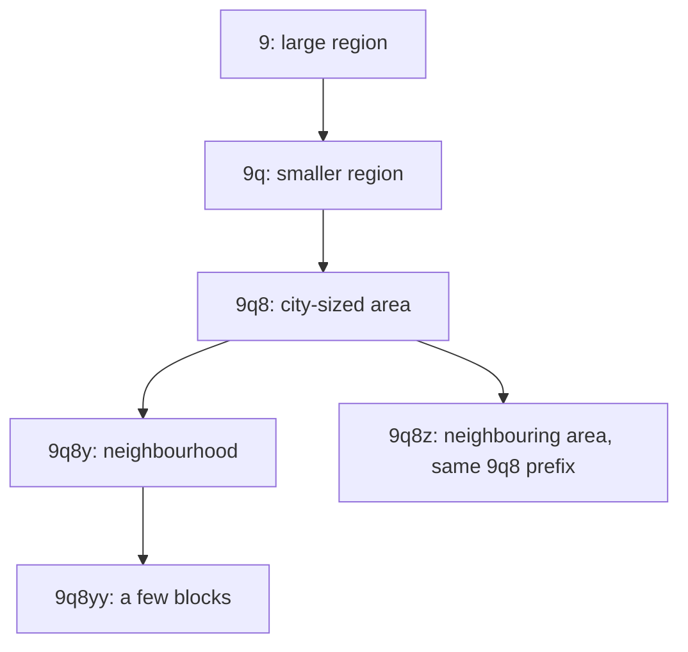

#### Quadtree

Recursively splits space into 4 quadrants. A quadrant is split again only when it holds too many points, so dense areas get finer cells.

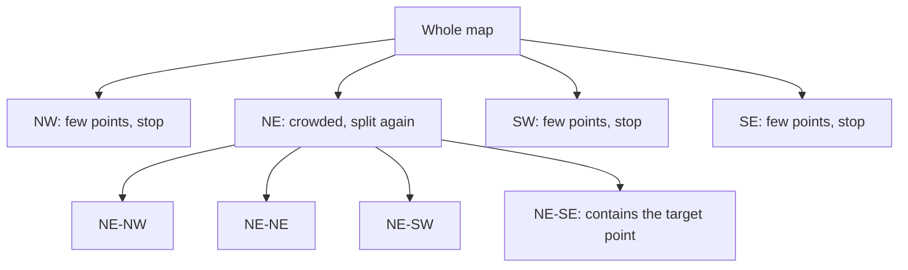

Searching for a point means walking down: map, NE, NE-SE. Only that branch is read.

#### R-Tree

Groups nearby objects into nested bounding rectangles. A search skips every rectangle that does not overlap the search area.

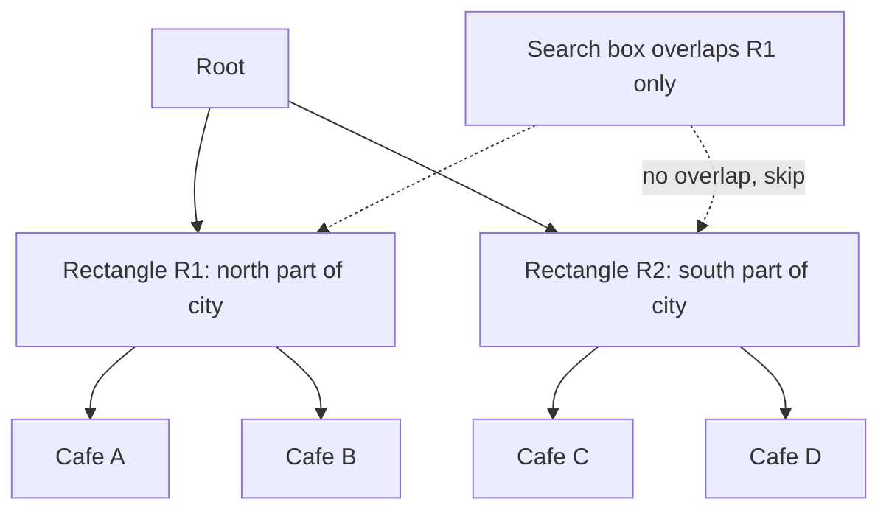

### 2.4 Inverted index

Built for text search. Instead of document to words, it stores word to documents.

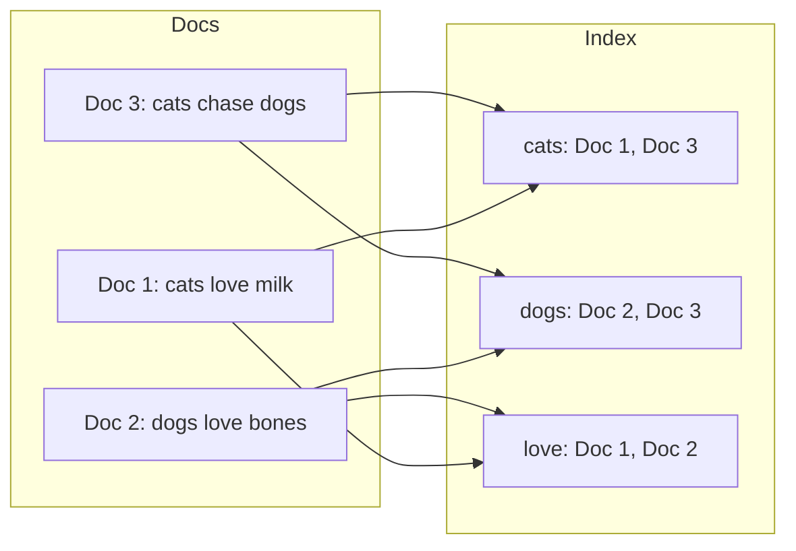

**Query: cats AND dogs**

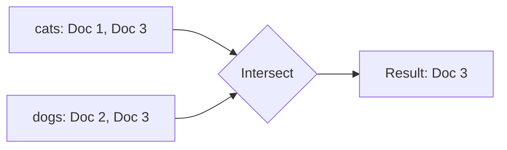

## 3. Which index should I use?

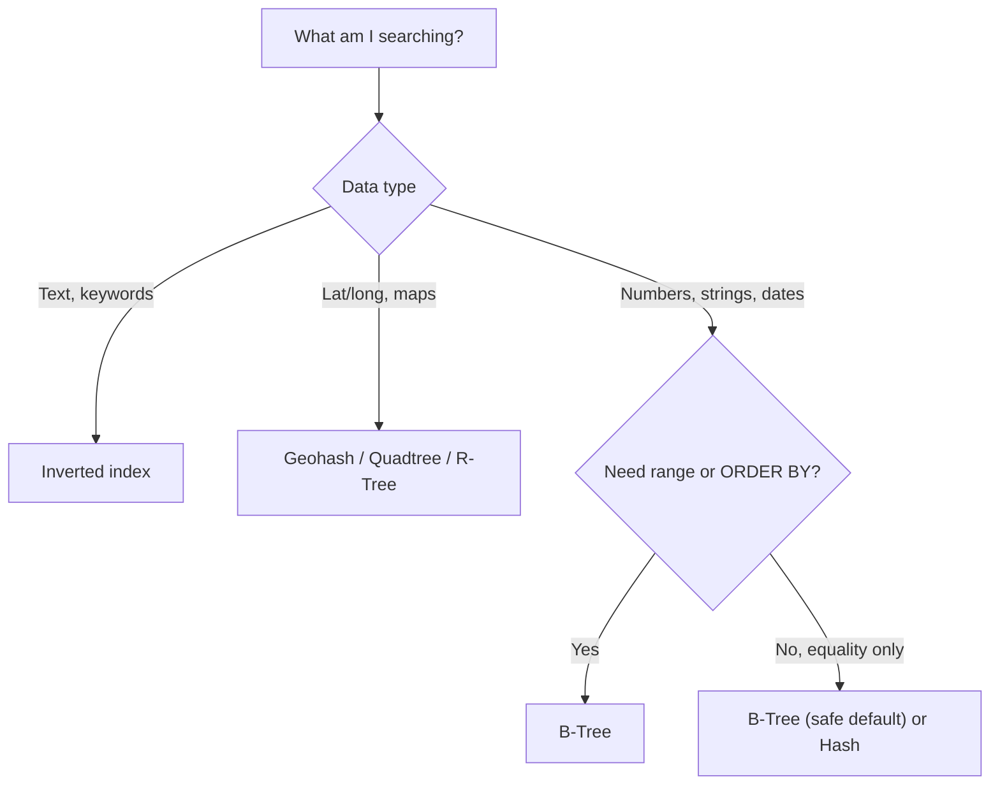

Rule of thumb: when in doubt, use a B-tree.

## 4. The trade-off

| | Without index | With index |
|---|---|---|
| Reads | Slow (scan all) | Fast (O(log N) for B-tree) |
| Writes (INSERT / UPDATE / DELETE) | Fast | Slower, every index must be updated |
| Disk space | Table only | Table + each index |

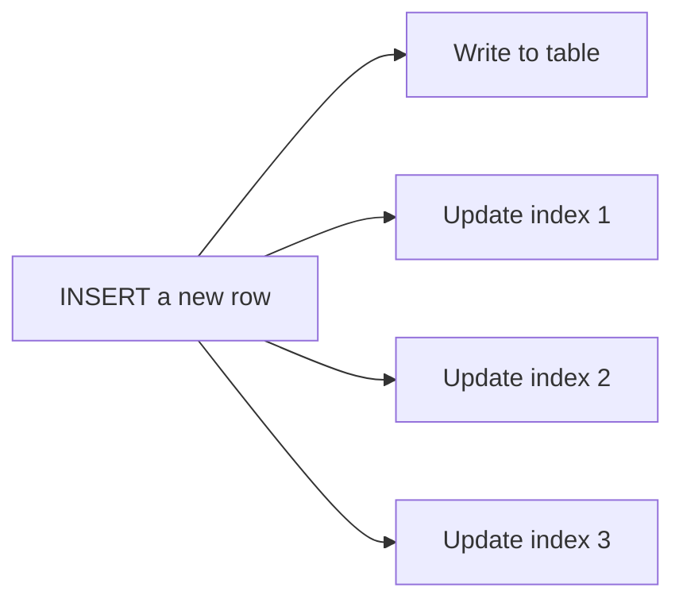

Indexes pay off for selective filters. If a filter matches a large share of the table, the planner may skip the index and do a Seq Scan anyway.

## 5. Summary

| Index | Best for | Weakness |
|---|---|---|
| B-Tree | Equality, ranges, sorting | Poor for 2D data |
| Hash | Exact match | No ranges or ordering |
| Geohash | Nearby search on a B-tree | Cells have edge cases at boundaries |
| Quadtree | Uneven point density | Deep trees in crowded areas |
| R-Tree | Areas and rectangles | More complex to maintain |
| Inverted | Full-text search | Larger storage, costly updates |