# Linked List Cycle II: Floyd's Algorithm

Problem: [LeetCode 142: Linked List Cycle II](https://leetcode.com/problems/linked-list-cycle-ii/). Given the head of a linked list, return the node where the cycle begins, or `null` if there is no cycle.

## Approach 1: Hash set (O(n) time, O(n) space)

```cpp
class Solution {
public:
    ListNode *detectCycle(ListNode *head) {
        unordered_set<ListNode*> st;
        ListNode* cur = head;
        while (cur != nullptr) {
            if (!st.insert(cur).second) return cur;   // already seen: cycle start
            cur = cur->next;
        }
        return nullptr;
    }
};
```

The first node you visit twice is the cycle start. It's simple, but the set costs O(n) memory.

## Approach 2: Floyd's tortoise and hare (O(n) time, O(1) space)

```cpp
class Solution {
public:
    ListNode *detectCycle(ListNode *head) {
        ListNode *slow = head, *fast = head;
        while (fast && fast->next) {
            slow = slow->next;
            fast = fast->next->next;
            if (slow == fast) {              // phase 1: they met inside the cycle
                ListNode *p = head;          // phase 2: restart one pointer at head
                while (p != slow) {
                    p = p->next;
                    slow = slow->next;
                }
                return p;                    // both meet at the cycle start
            }
        }
        return nullptr;                      // fast hit the end: no cycle
    }
};
```

## Why the reset works (animated)

> The animation is a separate file, `floyd_cycle.svg`. Keep it in the same folder as this `.md`. It loops on its own when the preview supports animated SVG (GitHub, VS Code, most browsers).



Example list: `3 → 2 → 0 → -4 → 5 → 7 → (back to 0)`.

### The distances

| Symbol | Meaning | In the example |
|--------|---------|----------------|
| `a` | steps from head to the cycle start | 2 |
| `b` | steps from the cycle start to the meeting point | 2 |
| `c` | length of the cycle | 4 |

### Phase 1: slow and fast meet

- When they meet, slow has walked `a + b` steps.
- Fast walks twice as far, `2(a + b)`. Fast is also inside the cycle, so the extra distance is whole laps: `2(a + b) = (a + b) + k·c` for some integer `k ≥ 1`.
- That simplifies to `a + b = k·c`.

### Phase 2: why the reset lands on the cycle start

Rearrange `a + b = k·c`:

```
a = k·c − b
  = (k − 1)·c + (c − b)
```

- `c − b` is the distance from the meeting point forward to the cycle start.
- So a pointer starting at the meeting point reaches the cycle start after `c − b` steps, plus any number of full laps, which land back on the same node.
- A pointer starting at the head reaches the cycle start after exactly `a` steps.
- These are the same number of steps, so if both move 1 step at a time, they arrive at the cycle start together.

### Trace of the example

| Tick | Slow | Fast | Notes |
|------|------|------|-------|
| 0 | 3 | 3 | start |
| 1 | 2 | 0 | |
| 2 | 0 | 5 | |
| 3 | -4 | 0 | fast has lapped around |
| 4 | 5 | 5 | **meet** (`a + b = 4 = 1·c`) |

| Tick | P (from head) | Slow (from meeting point) |
|------|---------------|---------------------------|
| 5 | 2 | 7 |
| 6 | 0 | 0 |

Both reach node `0`, which is the cycle start.

## Complexity

| Approach | Time | Space |
|----------|------|-------|
| Hash set | O(n) | O(n) |
| Floyd's | O(n) | O(1) |