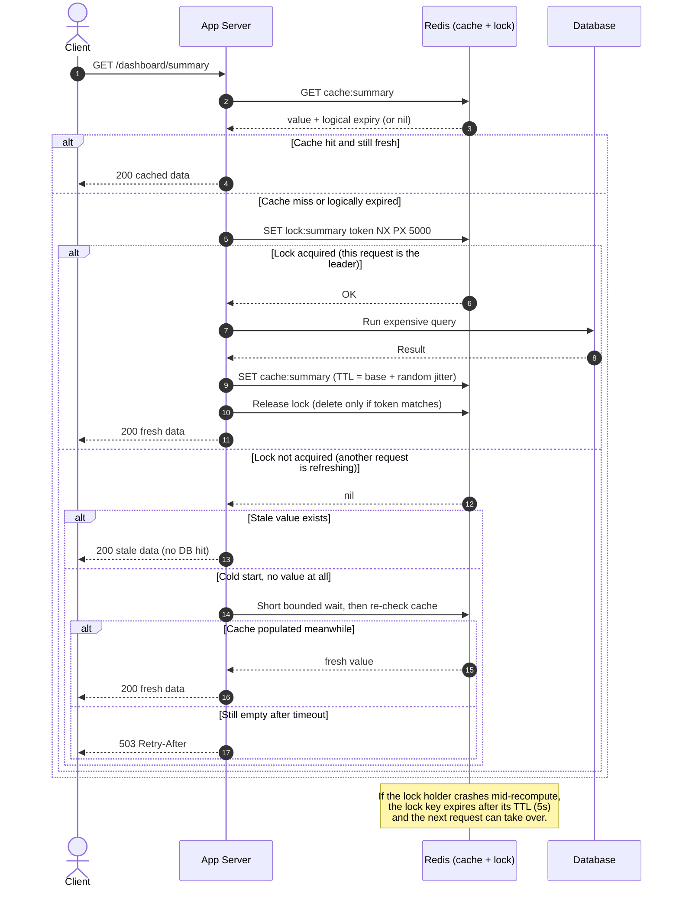

# Cache-Aside with Thundering Herd Prevention

## Problem

A hot key expires and many concurrent requests miss the cache at once. All of them query the database with the same expensive query, and the DB gets overloaded (cache stampede).

## Design summary

| Technique | Purpose |
|---|---|
| Cache-aside | App reads the cache first and falls back to the DB on a miss |
| TTL jitter | Randomise expiry (e.g. 300s ± 10%) so keys don't all expire together |
| Distributed lock (`SET NX PX`) | Only one request recomputes the value |
| Lock TTL | If the lock holder crashes, the lock expires and another request takes over |
| Stale fallback | Requests that lose the lock get the old value instead of blocking or hitting the DB |

## Sequence diagram

> To render this in VS Code, install the **Markdown Preview Mermaid Support** extension, then open the preview (`Ctrl+Shift+V`).

## Notes

- **Stale fallback implementation:** store the value with a *logical* expiry (soft TTL) inside the payload, and give the Redis key a longer *physical* TTL. After the logical expiry the value is "stale but still servable" while one request refreshes it.
- **Lock TTL sizing:** slightly longer than the normal recompute time. Too short and the lock expires mid-recompute, causing duplicate DB queries. Too long and a crashed holder blocks refreshes for longer.
- **Safe release:** store a unique token as the lock value and release it with a Lua script (`if GET == token then DEL`), so a slow request can't delete a lock that now belongs to someone else.
- **Multiple servers:** the lock lives in Redis, so it works across all app servers. An in-process mutex (singleflight) would only deduplicate per server.
- **Invalidation on writes:** when the underlying data changes, delete or overwrite `cache:summary` explicitly. TTL handles the rest.
- **Alternative: background refresh via queue.** Requests only read the cache, and a worker rebuilds the value. It needs the same two guards: deduplicate refresh jobs per key (an atomic `SET NX` again) and a visibility timeout so a crashed worker's job is re-delivered.