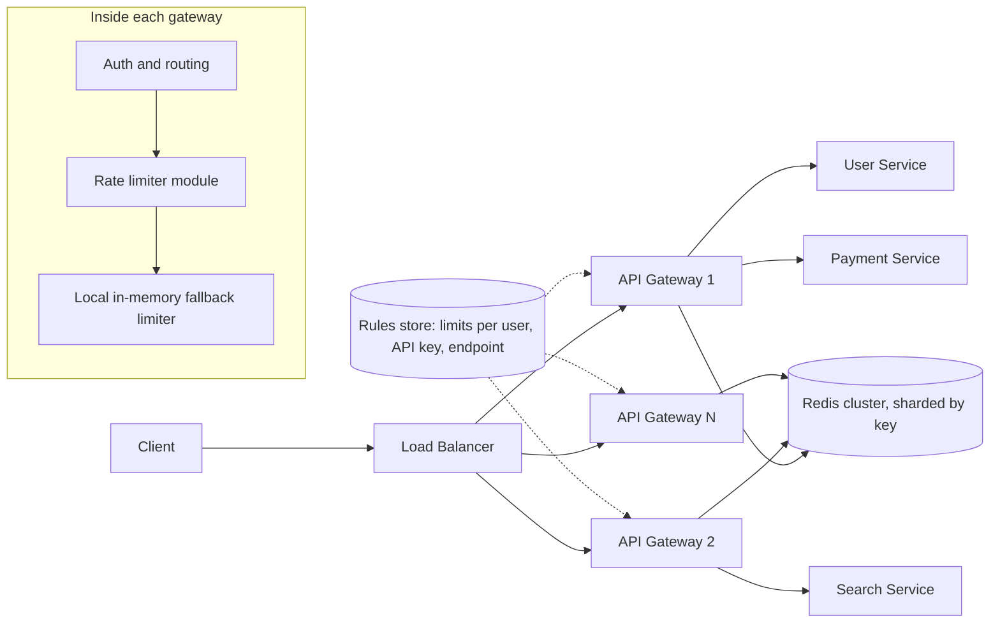
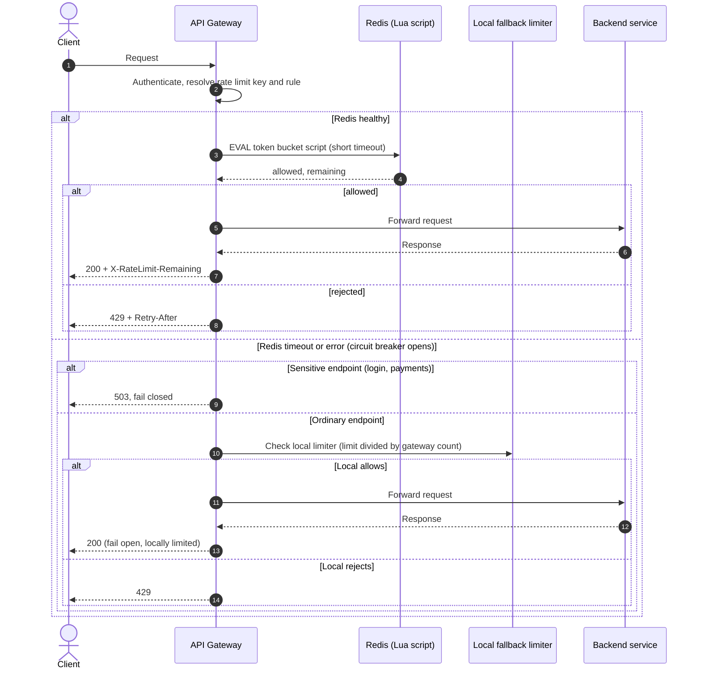

# Distributed Rate Limiter & API Gateway (HLD)

## 1. Problem

Build the layer in front of many microservices that decides, for every request, **allow or reject (HTTP 429)**.

Requirements:
- **Low latency:** runs on every request, so it must add very little overhead
- **Global limits:** the limit holds across many gateway instances, not per server
- **High throughput:** hundreds of thousands of checks per second
- **Defined failure behaviour:** a clear answer for when Redis is slow or unreachable

## 2. Architecture

The rate limiter is a **module inside the gateway** that talks to Redis directly. A separate limiter service would add a network hop to every request.



Notes:
- **Gateway failure:** run many gateway instances behind a load balancer with health checks, so one dying doesn't stop traffic.
- **Rules** (who, which endpoint, what limit) live in a config store and are cached locally in each gateway.
- **Redis** is sharded by rate-limit key, with replicas for availability.

## 3. What to limit by

| Identifier | Use when | Caveat |
|---|---|---|
| User ID | Authenticated endpoints | Best option once the user is known |
| API key | Public or partner APIs | One key per client application |
| IP address | Anonymous endpoints (login, signup) | Read from `X-Forwarded-For` behind a proxy. Many users can share one IP (offices, mobile carriers) |

MAC addresses are not usable. They exist only on the local network segment and are rewritten at every router hop, so servers never see the client's MAC.

Redis key format: `rl:{identifier_type}:{id}:{endpoint}`, for example `rl:user:42:/api/orders`.

## 4. Algorithm choice

### Token Bucket
A bucket holds up to N tokens and refills at a steady rate. Each request consumes a token, and no token means reject.

### Sliding Window Counter
Fixes the boundary problem of a plain fixed window, where a client can send 100 requests at 0:59 and another 100 at 1:01 (200 in 2 seconds). It keeps two counters (current and previous window) and estimates the true "last 60 seconds":

```
estimate = current_count + previous_count * (fraction of previous window still inside the sliding window)
```

Example: limit 100/min, now 25% into the current minute, previous window had 80, current has 30.
`estimate = 30 + 80 * 0.75 = 90`, which is under 100, so allow. It assumes the previous window's requests were evenly spread, so it is an approximation.

### Comparison

| | Token Bucket | Sliding Window Counter |
|---|---|---|
| Bursts | Allowed up to bucket size | Smoothed, no deliberate bursts |
| State per key | token count + last refill time | 2 counters |
| Strictness | Allows short bursts above the average rate | Closer to a true "N per window" |
| Good for | General APIs where bursts are fine | Strict limits (login attempts, paid quotas) |

**Choice:** Token Bucket by default, Sliding Window Counter for strict limits such as login attempts.

## 5. Atomic check with a Redis Lua script

Without a script, "read tokens, then decrement" are separate commands. Two gateways can both read 1 remaining token and both allow the request. A Lua script runs as a **single atomic operation** inside Redis, so no other command runs between its lines.

```lua
-- KEYS[1] = bucket key (e.g. "rl:user:42:/api/orders")
-- ARGV[1] = capacity (max tokens), ARGV[2] = refill rate (tokens per second), ARGV[3] = now (ms)
local capacity = tonumber(ARGV[1])
local rate     = tonumber(ARGV[2])
local now      = tonumber(ARGV[3])

-- 1. read the stored state
local data   = redis.call('HMGET', KEYS[1], 'tokens', 'last')
local tokens = tonumber(data[1])
local last   = tonumber(data[2])

-- new key: start with a full bucket
if tokens == nil then
  tokens = capacity
  last = now
end

-- 2. refill based on elapsed time, capped at capacity
local elapsed = math.max(0, now - last) / 1000
tokens = math.min(capacity, tokens + elapsed * rate)

-- 3. take a token if available
local allowed = 0
if tokens >= 1 then
  tokens = tokens - 1
  allowed = 1
end

-- 4. save state (even on reject) and set a TTL so idle keys disappear
redis.call('HSET', KEYS[1], 'tokens', tokens, 'last', now)
redis.call('PEXPIRE', KEYS[1], math.ceil(capacity / rate * 1000) * 2)

-- 5. return decision and remaining tokens
return {allowed, math.floor(tokens)}
```

Design notes:
- **State is saved even on reject**, so elapsed time isn't counted twice on the next request.
- **TTL** is twice the time to refill a full bucket. After that an idle bucket would be full anyway, so deleting it loses nothing.
- **Clock:** passing `now` from the gateway is simple, but gateway clocks can drift. Using `redis.call('TIME')` inside the script makes Redis the single clock.
- **Cost:** one Redis round trip per request.

Worked trace (capacity 3, refill 1/s, one request every 500 ms): requests 1-5 are allowed (the full bucket absorbs the burst), request 6 at 2.5 s is rejected (0.5 tokens), request 7 at 3.0 s is allowed. After the burst, the client is held to the refill rate.

## 6. Request flow and failure handling



### Fail-open vs fail-closed

| | Fail-open | Fail-closed |
|---|---|---|
| Behaviour when limiter is down | Let requests through | Reject requests |
| Favors | Availability | Protection |
| Risk | No protection exactly when traffic is high | A Redis problem becomes a full outage |
| Use for | Ordinary read APIs | Login, payments, anything abuse-sensitive |

### Rules of the fallback
- **Local limiter limit = global limit / number of gateways.** With a global limit of 100/min across 10 gateways, each local limiter allows about 10/min. Otherwise the combined limit becomes 1,000/min.
- **Short Redis timeout plus a circuit breaker.** After repeated failures, stop calling Redis for a few seconds and go straight to the fallback, then probe again. Retrying Redis inside a request adds latency to every request.
- **Jitter belongs on the client side.** Rejected clients should retry with exponential backoff and jitter, so they don't all return at the same instant (the same stampede problem as in the cache-aside design). The gateway's part is to return `Retry-After`.

## 7. API design

Rejected request:

```
HTTP/1.1 429 Too Many Requests
Retry-After: 12
X-RateLimit-Limit: 100
X-RateLimit-Remaining: 0
X-RateLimit-Reset: 1764327600
```

Allowed requests also carry `X-RateLimit-Limit` and `X-RateLimit-Remaining`, so well-behaved clients can pace themselves.

## 8. Scaling

- **Shard Redis by rate-limit key** (Redis Cluster hashes the key to a slot). Each key lives on one shard, so the Lua script stays atomic.
- **Replicas** for availability. Replication is asynchronous, so a failover can lose a few recent counts. For rate limiting that is acceptable.
- **Cache rules locally** in each gateway and refresh them periodically, so rule lookup never hits a database on the request path.
- **Hot keys:** a single very heavy key hits one shard. Mitigate with per-gateway local pre-limiting on top of the global check.
- **Gateways are stateless** and scale horizontally behind the load balancer.