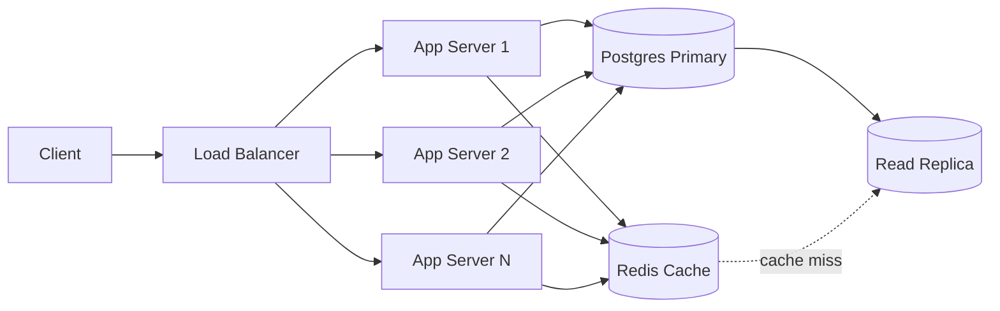

# System Design: URL Shortener

## 1. Requirements

### Functional
- Generate a short URL for a given long URL
  - Optional expiration time
  - Optional custom alias
- Redirect a short URL to the original URL

### Non-functional
- Low latency for redirects
- High availability
- Short codes must be unique
- Scale: ~100M daily users, ~1B stored URLs
- Read-heavy: redirects far outnumber URL creations

### Out of scope
Analytics, user accounts and auth, URL editing.

---

## 2. Capacity Estimation (rough)

| Quantity | Estimate |
|---|---|
| Redirects (assuming ~1 per daily user) | 100M / 86,400 s ≈ **1,200 req/s** average |
| Peak (assuming ~10x average) | **~12,000 req/s** |
| Storage (1B URLs x ~500 bytes) | **~500 GB** |

**Takeaways**
- 500 GB fits on a single Postgres instance, so sharding is not needed at first.
- The load is read-heavy, so caching gives the biggest win.
- Replicas are needed for availability, not for capacity.

---

## 3. API

### Create
```
POST /urls
Body: { "originalUrl": "...", "expirationTime"?: "...", "alias"?: "..." }
Response 201: { "shortUrl": "https://sho.rt/abc123" }
Errors: 400 invalid URL, 409 alias already taken
```

### Redirect
```
GET /{shortCode}
Response 302 -> Location: <originalUrl>
Errors: 404 not found, 410 expired
```

**Why 302 and not 301:** browsers cache 301 redirects permanently. That would bypass the server, so expiry could not be enforced and any future analytics would miss those hits. 302 keeps every redirect going through the service.

---

## 4. Data Model

**urls**

| Column | Notes |
|---|---|
| `shortCode` (PK) | The generated code, or the custom alias. |
| `originalUrl` | |
| `expirationTime` | Nullable. |
| `userId` | |
| `creationTime` | |

**users**

| Column | Notes |
|---|---|
| `userId` (PK) | |
| ... | |

- `shortCode` is the primary key because the hot query is a lookup by short code.
- A custom alias is stored in the same column, since it is just a user-chosen short code.
- Expiry is checked at read time: if `expirationTime` has passed, return 410. A periodic cleanup job can delete old rows.

---

## 5. Short Code Generation

### Code length
Base62 uses `a-z`, `A-Z` and `0-9`.

- 6 characters: 62^6 ≈ 5.7 x 10^10 combinations
- 7 characters: 62^7 ≈ 3.5 x 10^12 combinations

With 1B URLs, 6 characters would use about 1.8% of the space, so roughly 1 in 55 new codes would collide. At 7 characters, collisions are negligible. **7 characters is the safer choice.**

### Option A: Random base62
- Generate a random 7-character code and insert it.
- If the insert fails on the primary key's unique constraint, generate a new code and retry.
- Collisions are rare, so retries are cheap.
- **Race condition:** a "check, then insert" sequence is not safe, because two requests can pick the same code between the check and the insert. Insert directly and let the unique constraint decide.
- Codes are unguessable.

### Option B: Hash of the URL (for example, first 7 characters of an MD5 or SHA digest)
- Truncating the hash brings collisions back, so it needs the same retry logic as option A.
- The same URL always produces the same code, which is a mild advantage for deduplication but a problem if two users want separate codes (or different expiries) for the same URL.

### Option C: Counter encoded in base62
- No collisions, so no retry logic or extra DB read is needed.
- Codes are sequential, so anyone can enumerate URLs. This is mitigated with rate limiting, but short URLs for private links would be exposed.
- In a distributed setup the counter becomes a shared dependency, for example Redis `INCR`. It is usually handled by giving each app server a range of numbers to hand out locally.
- Custom aliases still need their own uniqueness check.

### Decision
Random base62 at 7 characters, with insert-and-retry on a unique-constraint violation. It is simple, there is no shared counter to scale, and codes are not guessable. A counter with ranges is the alternative if write retries ever become a problem.

---

## 6. High-Level Design



**Redirect flow (the hot path)**
1. Client requests `GET /{shortCode}`.
2. The app server checks Redis for `shortCode -> originalUrl`.
3. On a hit, return 302 immediately.
4. On a miss, read from a Postgres replica, store the result in Redis, and return 302.
5. If the row is missing, return 404. If it is expired, return 410.

**Create flow**
1. Client sends `POST /urls`.
2. The app server generates a code (or takes the alias) and inserts the row into Postgres.
3. If the insert fails on a duplicate key, retry with a new code, or return 409 for a custom alias.
4. Return the short URL.

---

## 7. Caching

- Cache `shortCode -> originalUrl` in Redis for redirects.
- Use LRU eviction. A small share of links gets most of the traffic, so a modest cache gets a high hit rate.
- Set the TTL to the smaller of a default (for example, 24 hours) and the URL's remaining time before expiry.
- Do **not** use the cache to check whether a new code is free. A cache miss does not mean the code is unused. The database's unique constraint is the source of truth.

---

## 8. Bottlenecks and Failure Handling

| Risk | Mitigation |
|---|---|
| App server failure | Stateless servers behind a load balancer, so traffic shifts to the others. |
| Redis failure | Fall back to Postgres replicas. Latency rises, but redirects still work. |
| Postgres primary failure | Promote a replica. Redirects continue from replicas in the meantime, and only creation is affected. |
| Read load too high for the DB | Add replicas and increase the cache hit rate. |
| Dataset outgrows one machine | Shard by `shortCode` hash. Not needed at ~500 GB. |
| Abuse (spam links, enumeration) | Rate limiting on creation and redirects. |